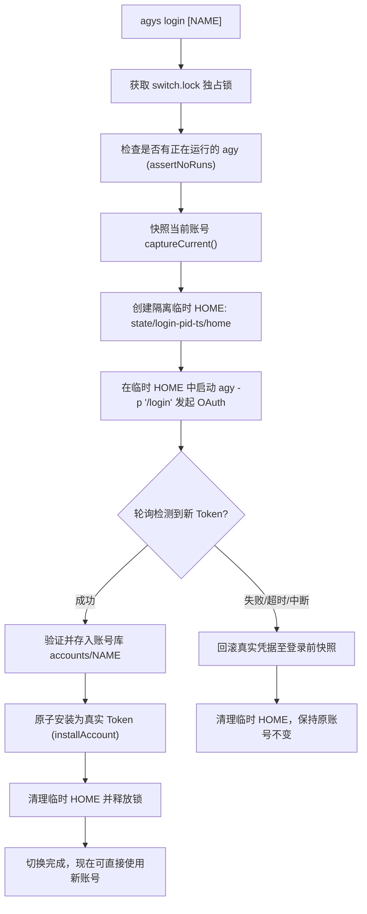

# agys - agy 无感多账号切换 CLI

`agys` 是 Google Antigravity CLI (`agy`) 的无感多账号切换工具与透明代理（Zero-Dependency CommonJS CLI for Node.js >= 18）。

---

## 目录

- [一句话目标](#一句话目标)
- [核心原理](#核心原理)
- [安装与卸载](#安装与卸载)
- [快速上手](#快速上手)
- [命令契约](#命令契约)
- [透明代理契约（重要）](#透明代理契约重要)
- [agys login 的工作机制](#agys-login-的工作机制)
- [安全性与限制](#安全性与限制)
- [故障排查](#故障排查)
- [手动验收清单 (MANUAL)](#手动验收清单-manual)

---

## 一句话目标

切换 agy 登录身份，同时保留全部本地会话历史（`conversations/*.db`、`history.jsonl`、`cache/`、`settings.json`、`installation_id`）。除 agys 专用子命令外，所有参数和 stdio 原样透传给 agy。

---

## 核心原理

在 Linux/WSL2 和 macOS 上，`agy` 的登录凭据独立存储于：
```text
~/.gemini/antigravity-cli/antigravity-oauth-token
```
而会话历史、上下文数据库和缓存位于同级目录下：
```text
~/.gemini/antigravity-cli/conversations/*.db
~/.gemini/antigravity-cli/conversation_summaries.db
~/.gemini/antigravity-cli/history.jsonl
~/.gemini/antigravity-cli/cache/
~/.gemini/antigravity-cli/settings.json
~/.gemini/antigravity-cli/installation_id
```

`agys` **只原子替换 OAuth token 文件**，绝不触碰或复制会话数据库与配置文件。
因此切换账号后，本地所有历史与 `--continue` / `--conversation` 均完全可用，无需重新登录或分叉配置目录。

---

## 安装与卸载

### 本地安装（立即可用）

在克隆或下载的 `agys` 仓库目录下执行：
```bash
npm install -g .
```

### 从 npm Registry 全局安装

```bash
npm install -g @aiif/agys
```

安装后即可直接在终端使用 `agys` 命令：
```bash
agys help
```

### 权限不足处理（无 sudo 环境）

如果系统全局 npm 目录需要 root/sudo 权限，可安装到用户主目录：
```bash
npm install -g --prefix "$HOME/.local" .
```
并确保 `$HOME/.local/bin` 已加入 `PATH`：
```bash
export PATH="$HOME/.local/bin:$PATH"
```

### 卸载

```bash
npm uninstall -g @aiif/agys
# 或若本地目录安装：
npm uninstall -g agys
```

---

## 快速上手

```bash
# 1. 保存当前已登录的 agy 凭据为工作账号
agys save work

# 2. 登录个人新账号（自动在临时环境中发起 OAuth 并切换）
agys login personal

# 3. 列出所有保存的账号与当前活跃账号
agys list

# 4. 以当前账号启动 agy 对话
agys

# 5. 切换到下一个可用账号并启动 agy
agys next

# 6. 仅切换账号，不启动 agy
agys use work
agys next --no-run
```

---

## 命令契约

| 命令 | 行为与说明 |
|---|---|
| `agys` | 不带参数：以当前 token 启动交互式 `agy` |
| `agys <agy args...>` | 其余参数原样转发给 `agy`（例如 `agys -c`、`agys -p "hi"`、`agys --model gemini-2.5-pro`） |
| `agys -- <agy args...>` | **逃生通道**：去掉第一个 `--`，后续所有参数无条件交给 agy（即使看起来像 agys 保留字） |
| `agys save [NAME]` | 将当前 token 保存为账号快照。默认名称取邮箱 `@` 前缀的 slug；已有相同邮箱时自动更新已有账号 |
| `agys login [NAME]` | 先安全快照当前账号；在隔离临时 `HOME` 中通过 `agy -p "/login"` 登录新账号；成功后保存并**切换为当前账号**。登录失败/中断自动回滚 |
| `agys list` / `agys ls` | 列出账号、邮箱、token 过期时间和当前活跃标记 `*`。绝不输出 token 原文 |
| `agys current` | 打印当前匹配到的账号名和邮箱；未保存输出 `unsaved` |
| `agys use NAME` / `agys switch NAME` | 切换到指定账号，**不启动** agy |
| `agys next [--no-run] [-- AGY_ARGS...]` | 轮换到下一个有效账号；默认立即启动 agy；`--no-run` 只切换；`--` 后参数传给 agy |
| `agys rm NAME [--force]` | 删除账号快照；删除当前活跃账号时需 `--force`（仅删快照，真实 token 保持有效） |
| `agys doctor` | 环境与健康诊断（Node、npm、agy、token、Keychain、会话目录、并发状态） |
| `agys help` / `agys --help` | 显示帮助文档与透明代理规则 |
| `agys version` / `agys --version` | 打印 `agys` 版本号 |

---

## 透明代理契约（重要）

`agys` 的核心设计定位是 `agy` 的**高保真透明代理**。为确保与原生 `agy` 完全一致的交互体验，契约如下：

1. **参数原样转发**：
   - 代理模式使用 `child_process.spawn(agyBin, args, { stdio: "inherit" })`。
   - 禁止 `exec`、`sh -c`、字符串拼接、重新排序或注入默认值。
   - 参数中的空格、单双引号、`=`、换行符和空字符串将原样送达 agy。
2. **只解析 argv[0]**：
   - 仅对第一个参数进行 agys 保留词的严格精确匹配。其余参数不解析。
   - 例外：`agys next` 会解析其专属的 `--no-run` 和第一个 `--`。
3. **保留词完整清单**：
   ```text
   help, --help, version, --version, save, login, list, ls, current, use, switch, next, rm, doctor
   ```
   - 仅以上保留词作为第一个参数时由 agys 接管。
   - 所有未列出的参数（包括 `-h`、`-c`、`-p`、`--model` 等）一律原样转发给 agy。
   - 未知的子命令（如 `agys models`）也会原样透传给 agy。
4. **逃生通道 (`--`)**：
   - 当第一个参数为 `--` 时，agys 剥离首个 `--`，并将后续全部参数直接传递给 agy。
   - 例如：`agys -- --help` 用于调用 agy 自带的 help；`agys -- list` 将 `list` 作为参数传递给 agy。
   - 出现在其它位置的 `--` 属于 agy 参数本身，原样转发。
5. **stdio 独占契约**：
   - 代理模式下，`stdout` 归 `agy` 独占。`agys` 绝不向 stdout 输出任何字节。
   - agys 的提示横幅、警告和错误信息统一输出至 `stderr`。
   - 非 TTY 环境或设置 `AGYS_QUIET=1` 时，静默抑制切换横幅。
6. **进程环境 (cwd/env)**：
   - 保持 `process.cwd()` 和 `process.env` 不变。
   - 不修改 `HOME`，不注入 `ANTIGRAVITY_*` 环境变量（`login` 的隔离 HOME 仅作用于登录子进程）。
   - agy 必须在系统的 `PATH` 中可执行；Shell 的 alias 或 function 无法被继承，必要时可通过 `AGYS_AGY_BIN=/path/to/agy` 指定。
7. **信号与退出码透传**：
   - agy 与 agys 运行在同一前台进程组，终端触发的 `SIGINT`（Ctrl+C）由系统组播送达，agys 不再重复发信号；agys 捕获信号并转换为标准退出码（SIGINT 为 130，SIGTERM 为 143）。发给 agys 的 SIGTERM 转发至 agy。
   - 代理模式下，agy 的退出码原样返回（即使是 2-7 的状态码，也不做改写）。
   - agys 自身的错误状态码（2-7）仅在启动 agy 之前或 agys 本地子命令中返回。

---

## agys login 的工作机制

新增账号登录采用**先保存、后隔离登录、再切换**的三阶段安全事务：



- **语义说明**：切换不是登出。登录开始前当前账号已完整入库；登录成功后新账号成为当前账号，旧账号随时可用 `agys use <旧账号>` 切回。
- **绝不调用 `/logout`**：绝不通过登出或清空 token 来登录新账号。
- **超时与中断**：默认 5 分钟超时（可通过 `AGYS_LOGIN_TIMEOUT` 自定义毫秒数）。若用户按 Ctrl+C 中断或登录超时，系统立即清理临时目录并回滚，原账号不受任何影响。

---

## 安全性与限制

1. **运行中的 agy 互斥保护**：
   - agy 进程会在后台定期刷新 OAuth refresh token 并重写 token 文件。
   - 若在 agy 运行期间强行切换账号，旧账号刷新的 token 可能覆盖新账号。
   - 因此 `agys login`、`agys use`、`agys next` 在切换前会检查运行中的 agy 进程；如存在则拒绝切换并退出码 3。请先退出正在运行的交互式会话。
2. **跨账号云端续聊限制**：
   - 本地 SQLite 历史数据会完整保留，`--continue` 能读取本地对话摘要。
   - 但若 Google 云端服务对特定对话进行了账号属主绑定校验，跨账号 `--continue` 可能会被云端拒绝。如遇到云端拒绝，`agys` 不会修改或破坏本地数据库。
3. **关联性风险提示**：
   - 同一物理机、相同的 `installation_id` 和出口 IP 可能会被 Google 服务端关联。`agys` 是本地凭据切换与配额轮换工具，**不是防封或反指纹检测工具**。
4. **macOS Keychain 说明**：
   - macOS 上除 token 文件外，agy 可能同步使用 Keychain (`service: gemini, account: antigravity`)。
   - `agys` 会对 Keychain 进行事务镜像：切换时先写 Keychain，成功后原子写文件；若文件写失败则回滚 Keychain。
   - 由于 macOS `security` 命令的限制，写入密码时密码会短暂存在于命令参数中。请勿在非受信任的多人共享系统上使用。

---

## 环境变量速查

| 环境变量 | 说明 | 默认值 |
|---|---|---|
| `AGYS_HOME` | 覆盖 agys 配置状态目录 | `~/.config/agys` |
| `AGYS_AGY_TOKEN` | 覆盖 agy token 路径 | `~/.gemini/antigravity-cli/antigravity-oauth-token` |
| `AGYS_AGY_BIN` | 覆盖 agy 可执行文件路径 | `agy` (从 PATH 查找) |
| `AGYS_LOGIN_TIMEOUT` | `agys login` 超时毫秒数 | `300000` (5分钟) |
| `AGYS_LOGIN_PROMPT` | 传递给 agy 的 login 指令 | `/login` |
| `AGYS_KEYCHAIN_SERVICE` | macOS Keychain 服务名 | `gemini` |
| `AGYS_KEYCHAIN_ACCOUNT` | macOS Keychain 账号名 | `antigravity` |
| `AGYS_KEYCHAIN_WRITE=1` | 允许创建尚不存在的 Keychain 条目 | `0` |
| `AGYS_QUIET=1` | 静默模式，不向 stderr 输出切换横幅 | `0` |
| `AGYS_SKIP_RUNNING_CHECK=1` | 仅测试使用，跳过 ps 进程扫描 | `0` |

---

## 故障排查

1. **`command not found: agys`**：
   - 检查 npm 全局 bin 路径是否在 PATH 中。可运行 `npm prefix -g` 确认 prefix，将 `<prefix>/bin` 添加到 `PATH`。
2. **`npm install -g` 报错 `EACCES`**：
   - 使用自定义 prefix 避免 root 权限：`npm install -g --prefix "$HOME/.local" .`。
3. **`agys save` 退出码 5：`no current token found`**：
   - 本机尚未通过 agy 登录任何账号。请先运行 `agy` 或 `agys login` 进行初始登录。
4. **`agys next` / `agys use` 退出码 3**：
   - 检测到后台或前台有其它正在运行的 `agy` 进程。请先退出正在运行的 agy 会话。
5. **`agys doctor` 退出码 5 (identity is divergent)**：
   - macOS 系统上 token 文件中的邮箱与 Keychain 中的邮箱不一致。运行 `agys use <NAME>` 重新对齐凭据。

---

## 手动验收清单 (MANUAL)

以下测试需在真实多账号与对应操作系统真机上完成验证：

- [ ] **macOS 真机 Keychain 验证**：
  1. 在 macOS 真机上安装 `npm install -g .`；
  2. 运行 `agys doctor`，检查 Keychain 状态；
  3. 执行 `agys save work`；
  4. 检查 Keychain 内容是否与 `~/.gemini/antigravity-cli/antigravity-oauth-token` 一致。
- [ ] **双账号真实 Google OAuth 切换**：
  1. 当前已登录账号 A，`agys save account_a`；
  2. 执行 `agys login account_b`，在弹出的浏览器中完成账号 B 的登录；
  3. 命令完成后 `agys current` 为 `account_b`，`agys list` 显示 `account_a` 与 `account_b`；
  4. 执行 `agys use account_a`，切回账号 A；
  5. 检查 `~/.config/agys/state/` 无 `login-*` 残留。
- [ ] **跨账号云端 `--continue` 连通性测试**：
  1. 在账号 A 下发送包含特征暗号的提问：`agy -p "今天的暗号是 PHOENIX"`；
  2. `agys save a`；
  3. 切换至账号 B：`agys use b`；
  4. 执行 `agy -c -p "暗号是什么？"`；
  5. 记录 Google 云端后端是否接受跨账号会话续聊，如失败记录完整后端错误响应。

---

## 许可证

[MIT License](LICENSE) © 2026 agys contributors
